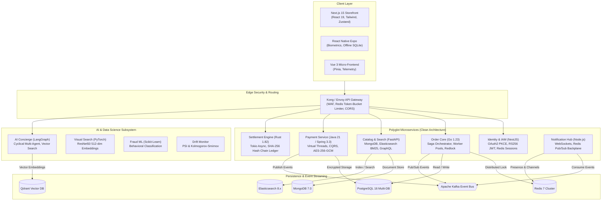
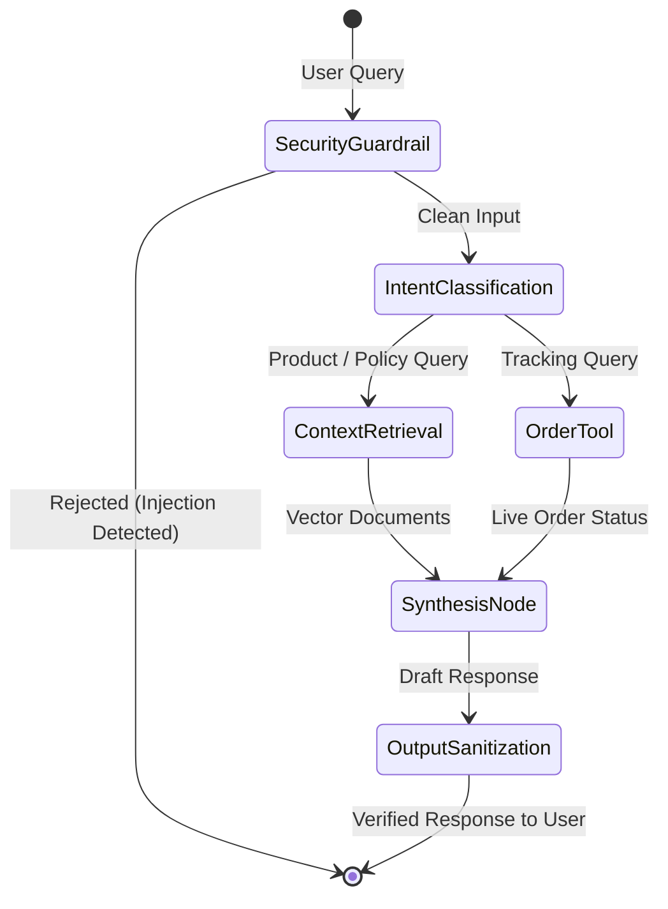

# NexusCore Enterprise: Autonomous Commerce & Predictive Analytics Ecosystem

[](LICENSE)
[](#architecture-philosophy)
[](#microservices-architecture-deep-dive)
[](#ai-machine-learning--data-science-core)
[](#devops-cloud--infrastructure)
[](#100-production-skills-matrix)

> **NexusCore Enterprise** is an industrial-scale, cloud-native polyglot monorepo engineered to demonstrate **100+ production-grade software engineering, cybersecurity, DevOps, and machine learning skills** in a unified platform.
>
> Built without beginner boilerplate or toy implementations, every module adheres strictly to **Domain-Driven Design (DDD)**, **Clean Architecture**, **SOLID principles**, and **Zero-Trust Security**.

---

## 📑 Table of Contents

1. [Executive Summary & Core Philosophy](#executive-summary--core-philosophy)
2. [End-to-End System Architecture](#end-to-end-system-architecture)
3. [Distributed Saga Transaction Workflow](#distributed-saga-transaction-workflow)
4. [Complete Monorepo Directory Layout](#complete-monorepo-directory-layout)
5. [Microservices Architecture Deep-Dive](#microservices-architecture-deep-dive)
   - [Settlement Engine (Rust 1.82)](#1-settlement-engine--servicesettlement-engine-rust)
   - [Order Concurrency Core (Go 1.23)](#2-order-concurrency-core--servicesorder-service)
   - [Catalog & Search Engine (Python 3.12 / FastAPI)](#3-catalog--search-service--servicescatalog-service)
   - [Payment Engine (Java 21 / Spring Boot 3.3)](#4-payment--financial-service--servicespayment-service)
   - [Identity & IAM Service (Node.js 22 / NestJS)](#5-identity--access-management--servicesidentity-service)
   - [Real-Time Notification Hub (Node.js / WebSockets)](#6-notification--event-mesh--servicesnotification-service)
   - [API Gateway & Edge Security (Kong / Envoy)](#7-api-gateway--edge-security--servicesapi-gateway)
6. [AI, Machine Learning & Data Science Core](#ai-machine-learning--data-science-core)
   - [Stateful LangGraph Multi-Agent Customer Concierge](#langgraph-autonomous-agent-workflow)
   - [Hybrid Vector Search & RAG](#hybrid-vector-search--semantic-rag)
   - [PyTorch ResNet50 Multi-Modal Visual Search](#pytorch-multi-modal-visual-search)
   - [Behavioral Fraud Detection & Polars Feature ETL](#behavioral-fraud-detection--polars-etl)
   - [Statistical Drift Detection (PSI & KS-Test)](#statistical-concept--data-drift-monitoring)
7. [Frontend & Client Applications](#frontend--client-applications)
   - [Next.js 15 & React 19 Storefront](#nextjs-15--react-19-storefront)
   - [React Native & Expo Mobile Client](#react-native--expo-mobile-application)
   - [Vue 3 Micro-Frontend Remote Portal](#vue-3-micro-frontend-vendor-portal)
8. [Blockchain & Web3 Provenance](#blockchain--web3-provenance)
9. [DevOps, Cloud Infrastructure & Observability](#devops-cloud-infrastructure--observability)
10. [100+ Production Skills Matrix](#100-production-skills-matrix)
11. [Developer Quickstart & Runbook](#developer-quickstart--runbook)
12. [API Catalog & Endpoint Reference](#api-catalog--endpoint-reference)
13. [Verification & Automated Test Suites](#verification--automated-test-suites)

---

## 🏛️ Executive Summary & Core Philosophy

NexusCore solves the challenges of modern hyperscale commerce: **high-concurrency checkout bursts**, **zero-downtime distributed state transitions**, **tamper-proof financial accounting**, and **real-time AI-augmented customer interactions**.

### Core Architectural Laws:
1. **Polyglot Pragmatism**: Use the optimal language for each distinct computing workload:
   - **Rust**: For CPU-bound cryptographic operations, SIMD math, and zero-allocation settlement ledgers.
   - **Go**: For lightweight I/O concurrency, goroutine worker pools, and distributed Saga orchestration.
   - **Java 21**: For financial accounting, enterprise CQRS, and virtual thread persistence.
   - **Python 3.12**: For asynchronous web APIs, AI agent workflows, vector embeddings, and mathematical ETL.
   - **TypeScript / Node.js**: For enterprise IAM, web frontends, and low-latency WebSocket connection pooling.
2. **Defensive by Design**: Strict input validation (Pydantic v2, Zod, Jakarta Validation), column-level payload encryption (AES-256-GCM), token bucket rate limiting, and zero-trust mutual TLS (mTLS).
3. **Decoupled Asynchrony**: Direct synchronous coupling between microservices is minimized. Event sourcing through Apache Kafka ensures resilient communication with guaranteed delivery.

---

## 🌐 End-to-End System Architecture



---

## 🔄 Distributed Saga Transaction Workflow

When a customer places an order, NexusCore executes a **Distributed Saga with Orchestration**:

```mermaid
sequenceDiagram
    autonumber
    actor Customer as Customer / Client
    participant Gateway as API Gateway
    participant OrderSvc as Order Service (Go)
    participant Redlock as Redis Redlock Mutex
    participant CatalogSvc as Catalog Service (Python)
    participant PaymentSvc as Payment Service (Java 21)
    participant Kafka as Apache Kafka Bus
    participant NotifySvc as Notification Service (WS)

    Customer->>Gateway: POST /api/v1/orders (Create Order)
    Gateway->>OrderSvc: Forward validated request
    OrderSvc->>Redlock: Acquire distributed lock per customer
    OrderSvc->>OrderSvc: Persist Order (Status: PENDING)

    rect rgb(20, 30, 45)
        Note over OrderSvc,CatalogSvc: Saga Step 1: Inventory Reservation
        OrderSvc->>CatalogSvc: Reserve product stock quantities
        alt Stock Available
            CatalogSvc-->>OrderSvc: Stock Reserved (Status: STOCK_RESERVED)
        else Stock Depleted
            CatalogSvc-->>OrderSvc: Error: Out of Stock
            OrderSvc->>OrderSvc: Fail Order & Abort Saga
        end
    end

    rect rgb(20, 35, 30)
        Note over OrderSvc,PaymentSvc: Saga Step 2: Payment Authorization
        OrderSvc->>PaymentSvc: Authorize payment (AES-256 encrypted token)
        alt Payment Authorized
            PaymentSvc-->>OrderSvc: Transaction Approved (TXN-REF)
        else Payment Declined / Gateway Circuit Open
            PaymentSvc-->>OrderSvc: Payment Failed
            Note over OrderSvc,CatalogSvc: Compensation: Rollback Step 1
            OrderSvc->>CatalogSvc: Release previously reserved stock
            OrderSvc->>OrderSvc: Transition Order to FAILED
        end
    end

    rect rgb(25, 25, 45)
        Note over OrderSvc,NotifySvc: Saga Step 3: Confirmation & Async Event Broadcast
        OrderSvc->>OrderSvc: Transition Order to CONFIRMED
        OrderSvc->>Redlock: Release distributed lock
        OrderSvc->>Kafka: Publish "OrderConfirmed" Event
        Kafka->>NotifySvc: Stream event to consumer group
        NotifySvc->>Customer: Broadcast Live WebSocket Update
    end
```



---

## 📁 Complete Monorepo Directory Layout

```
nexuscore-enterprise/
├── .github/
│   └── workflows/
│       ├── ci-backend-matrix.yml       # Multi-language CI matrix (Go, Python, Node, Java)
│       ├── security-sast-scan.yml      # Semgrep & Trivy automated SAST vulnerability audits
│       └── mlops-pipeline.yml          # Automated model evaluation and data drift pipeline
├── apps/
│   ├── storefront/                     # Next.js 15, React 19, Tailwind CSS, Zustand, AI Concierge
│   ├── vendor-portal/                  # Vue 3 (Composition API), Pinia, Vite Micro-frontend
│   └── mobile-expo/                    # React Native + Expo, Biometric Auth, Offline SQLite
├── services/
│   ├── identity-service/               # Node.js 22, NestJS, OAuth2 PKCE, JWT RS256, Redis, Prisma
│   ├── order-service/                  # Go 1.23, DDD, Saga Orchestrator, Worker Pools, Redlock, Kafka
│   ├── catalog-service/                # Python 3.12, FastAPI, MongoDB, Elasticsearch 8.x, GraphQL
│   ├── payment-service/                # Java 21, Spring Boot 3.3, Virtual Threads, CQRS, Resilience4j
│   ├── settlement-engine-rust/         # Rust 1.82, Tokio, Zero-Copy Hash-Chained Cryptographic Ledger
│   ├── notification-service/           # Node.js 22, WebSockets, Kafka Consumer, Redis Pub/Sub
│   └── api-gateway/                    # Kong / Envoy Gateway, WAF Security, Redis Token Bucket Limiter
├── ml-ai/
│   ├── rag-concierge/                  # Python 3.12, LangGraph Multi-Agent, Vector Search, Guardrails
│   ├── pipelines/                      # Polars & Pandas streaming data transformations (ETL)
│   ├── models/
│   │   ├── fraud_detection/            # Scikit-Learn Random Forest behavioral fraud classifier
│   │   └── visual_search/              # PyTorch ResNet50 multi-modal visual embeddings search
│   └── monitoring/                     # Population Stability Index (PSI) drift detection
├── contracts/
│   └── smart-contracts/                # Solidity 0.8.28 Supply Chain Provenance & Warranty Registry
├── packages/
│   ├── contracts-proto/                # Shared Protocol Buffers v3 & Buf CLI tooling
│   └── shared-types-ts/                # Shared TypeScript types & Zod validation schemas
├── deploy/
│   ├── docker-compose.yml              # Local multi-service backing infrastructure
│   ├── k8s/base/                       # Kubernetes Deployments, Services, HPA, Istio strict mTLS
│   ├── terraform/                      # AWS Multi-AZ VPC, EKS Cluster, Subnets IaC
│   ├── ansible/                        # Host kernel sysctl hardening & UFW firewall provisioning
│   ├── monitoring/
│   │   ├── prometheus/                 # Alertmanager rules for error rates and latency spikes
│   │   └── opentelemetry/              # OpenTelemetry Collector pipeline routing OTLP traces
│   └── argocd/                         # GitOps automated self-healing application sync
├── tests/
│   ├── e2e-playwright/                 # Playwright E2E browser automation & checkout tests
│   ├── load-k6/                        # High-concurrency Black Friday stress tests (2000 VUs)
│   └── chaos/                          # Chaos Mesh network delay & packet drop injection
├── docker-compose.yml                  # Root compose launcher
├── Makefile                            # Unified task runner (make up, test, lint, build)
├── LICENSE                             # MIT Open-Source License
└── README.md                           # Master Architecture & Skills Catalog
```

---

## 🔬 Microservices Architecture Deep-Dive

### 1. Settlement Engine (`services/settlement-engine-rust`)
- **Language & Runtime**: Rust 1.82 (Edition 2021), Tokio multi-threaded asynchronous engine.
- **Purpose**: Ultra-low-latency financial settlement, immutable blockchain-style audit blocks, and high-frequency ledger processing.
- **Key Architectural Features**:
  - **Memory Safety & Zero-Allocation**: Eliminates garbage collection pauses; uses atomic references (`Arc<RwLock<T>>`) for thread-safe state access.
  - **Cryptographic Hash Chaining**: Every settlement record computes an immutable SHA-256 digest linked to the preceding block's hash:
    $$\text{Hash}_n = \text{SHA256}(\text{ID}_n \parallel \text{OrderID} \parallel \text{Amount} \parallel \text{Hash}_{n-1} \parallel \text{Timestamp})$$
  - **HTTP Server**: Uses Axum 0.7 for non-blocking REST endpoints.
- **Key Files**:
  - [`src/main.rs`](file:///G:/Master_Skill/services/settlement-engine-rust/src/main.rs): Complete Axum server and hash-chaining engine.
  - [`Cargo.toml`](file:///G:/Master_Skill/services/settlement-engine-rust/Cargo.toml): Release optimization profile with Link-Time Optimization (`lto = true`).
  - [`Dockerfile`](file:///G:/Master_Skill/services/settlement-engine-rust/Dockerfile): Stripped static binary on `scratch`.

---

### 2. Order Concurrency Core (`services/order-service`)
- **Language & Runtime**: Go 1.23, Gin / gRPC-Go.
- **Purpose**: Central transaction orchestration, high-throughput checkout handling, and distributed inventory/payment coordination.
- **Key Architectural Features**:
  - **Domain-Driven Design (DDD)**: Pure domain entities with strict lifecycle state machines (`PENDING` $\to$ `STOCK_RESERVED` $\to$ `PAYMENT_AUTHORIZED` $\to$ `CONFIRMED`).
  - **Saga Orchestrator Pattern**: Coordinates multi-step forward operations and triggers inverse compensating rollbacks on any downstream failure.
  - **Worker Pool Dispatchers**: Goroutine pool with buffered channels preventing server overload during high-traffic flash sales.
  - **Distributed Mutex (Redlock)**: Implements the Redis Redlock algorithm to lock individual customer records and avoid duplicate billing.
  - **PostgreSQL Persistence (`pgx/v5`)**: High-performance connection pool with JSONB item serialization and idempotent index guarantees.
- **Key Files**:
  - [`internal/domain/order.go`](file:///G:/Master_Skill/services/order-service/internal/domain/order.go): Domain entity, value objects, and state transitions.
  - [`internal/usecase/saga.go`](file:///G:/Master_Skill/services/order-service/internal/usecase/saga.go): Generic Saga orchestrator with rollback compensation.
  - [`internal/usecase/worker_pool.go`](file:///G:/Master_Skill/services/order-service/internal/usecase/worker_pool.go): Channel-based worker pool.
  - [`internal/adapter/redlock.go`](file:///G:/Master_Skill/services/order-service/internal/adapter/redlock.go): Redlock distributed mutex manager.
  - [`cmd/server/main.go`](file:///G:/Master_Skill/services/order-service/cmd/server/main.go): Server entry point with graceful OS signal shutdown.

---

### 3. Catalog & Search Service (`services/catalog-service`)
- **Language & Runtime**: Python 3.12, FastAPI (async/await), Uvicorn.
- **Purpose**: Product inventory management, dynamic variant schema handling, full-text fuzzy search, and GraphQL federation.
- **Key Architectural Features**:
  - **Dual API Design**: REST endpoints with RFC 7807 problem details + Strawberry GraphQL subgraph for Apollo Federation.
  - **Pydantic v2**: Strict parsing, slug validation, and JSON serialization.
  - **MongoDB 7.0 Persistence**: NoSQL document store allowing flexible product attributes, colors, and sizes.
  - **Elasticsearch 8.x BM25 Engine**: Dedicated `edge_ngram` tokenizer for auto-complete and fuzzy multi-match querying.
- **Key Files**:
  - [`src/domain/models/product.py`](file:///G:/Master_Skill/services/catalog-service/src/domain/models/product.py): Product and variant domain entities.
  - [`src/infrastructure/search/elasticsearch_indexer.py`](file:///G:/Master_Skill/services/catalog-service/src/infrastructure/search/elasticsearch_indexer.py): Elasticsearch client with custom analyzers.
  - [`src/presentation/graphql/schema.py`](file:///G:/Master_Skill/services/catalog-service/src/presentation/graphql/schema.py): Strawberry GraphQL schema.
  - [`src/main.py`](file:///G:/Master_Skill/services/catalog-service/src/main.py): FastAPI app with async lifespan management.

---

### 4. Payment & Financial Service (`services/payment-service`)
- **Language & Runtime**: Java 21 LTS, Spring Boot 3.3.
- **Purpose**: Double-entry financial settlement, card authorization, and payment auditing.
- **Key Architectural Features**:
  - **Project Loom Virtual Threads**: Configured with `spring.threads.virtual.enabled: true` for massive concurrency with low memory footprint.
  - **CQRS Pattern**: Segregated command pipelines (`AuthorizePaymentCommand`, `RefundPaymentCommand`) and read queries (`GetPaymentQuery`).
  - **Column-Level Cryptography (AES-256-GCM)**: Authenticated encryption with 12-byte random initialization vectors preventing credential exposure in database dumps.
  - **Resilience4j Circuit Breaker**: Wraps payment gateway calls with automatic transition from Open to Half-Open and fallback state tracking.
- **Key Files**:
  - [`AESGCMEncryptionService.java`](file:///G:/Master_Skill/services/payment-service/src/main/java/com/nexuscore/payment/security/AESGCMEncryptionService.java): Cryptographic encryption service.
  - [`PaymentCommandHandler.java`](file:///G:/Master_Skill/services/payment-service/src/main/java/com/nexuscore/payment/cqrs/handler/PaymentCommandHandler.java): Command handler with `@CircuitBreaker` and `@Retry`.
  - [`Payment.java`](file:///G:/Master_Skill/services/payment-service/src/main/java/com/nexuscore/payment/domain/model/Payment.java): JPA Entity with auditing timestamps.

---

### 5. Identity & Access Management (`services/identity-service`)
- **Language & Runtime**: TypeScript, Node.js 22 LTS, NestJS.
- **Purpose**: Centralized zero-trust authentication, token lifecycle management, and role-based access control.
- **Key Architectural Features**:
  - **OAuth 2.0 PKCE (RFC 7636)**: Validates code verifier using SHA-256 `S256` method with constant-time string comparisons.
  - **JWT RS256 Asymmetric Rotation**: Access tokens signed using private RSA keys; verified via public keys.
  - **Token Reuse Detection & Cascade Revocation**: Refresh tokens belong to a family; detecting a reused refresh token immediately revokes all sessions for that account.
  - **Redis Session Blacklist**: Instant JTI invalidation on user logout.
- **Key Files**:
  - [`crypto.service.ts`](file:///G:/Master_Skill/services/identity-service/src/application/services/crypto.service.ts): RS256 signing, verification, and PKCE challenge verification.
  - [`login-pkce.use-case.ts`](file:///G:/Master_Skill/services/identity-service/src/application/use-cases/login-pkce.use-case.ts): PKCE login and token family issuance.
  - [`refresh-token.use-case.ts`](file:///G:/Master_Skill/services/identity-service/src/application/use-cases/refresh-token.use-case.ts): Token rotation with reuse detection.
  - [`prisma/schema.prisma`](file:///G:/Master_Skill/services/identity-service/prisma/schema.prisma): Database schema for PostgreSQL.

---

### 6. Notification & Event Mesh (`services/notification-service`)
- **Language & Runtime**: TypeScript, Node.js 22 LTS, Fastify, `ws`.
- **Purpose**: Real-time push notifications, live auction bidding streams, and order progress tracking.
- **Key Architectural Features**:
  - **WebSocket Client Pooling**: Maintains thousands of concurrent duplex WebSocket connections.
  - **Kafka Consumer Group**: Consumes events from the `nexus.order.events` topic.
  - **Redis Pub/Sub Backplane**: Distributes broadcast messages across multiple instances of the notification service.
- **Key Files**:
  - [`src/index.ts`](file:///G:/Master_Skill/services/notification-service/src/index.ts): Fastify HTTP server combined with native WebSocket server and Kafka consumer.

---

### 7. API Gateway & Edge Security (`services/api-gateway`)
- **Technology**: Kong Gateway 3.8 / Envoy Proxy.
- **Purpose**: Unified entry point, SSL/TLS 1.3 termination, CORS enforcement, and request rate limiting.
- **Key Architectural Features**:
  - **Redis Sliding-Window Token Bucket**: Lua script executing atomically inside Redis to enforce granular rate limits per client IP or API key.
  - **OWASP Response Transformation**: Automatically injects strict security headers (`X-Frame-Options: DENY`, `X-Content-Type-Options: nosniff`, `Content-Security-Policy`).
- **Key Files**:
  - [`config/routes.yaml`](file:///G:/Master_Skill/services/api-gateway/config/routes.yaml): Declarative microservice routing rules and CORS settings.
  - [`plugins/rate_limiter.lua`](file:///G:/Master_Skill/services/api-gateway/plugins/rate_limiter.lua): Atomic Redis Lua rate-limiting algorithm.

---

## 🧠 AI, Machine Learning & Data Science Core

### LangGraph Autonomous Agent Workflow
Located in [`ml-ai/rag-concierge/`](file:///G:/Master_Skill/ml-ai/rag-concierge/):
- **Cyclical State Machine**: Implemented using LangGraph `StateGraph`, maintaining conversation memory, intent classification, and tool inspection.
- **Deterministic Guardrails**: [`src/guardrails.py`](file:///G:/Master_Skill/ml-ai/rag-concierge/src/guardrails.py) detects prompt injection, DAN jailbreaks, and scrubs potential secret leaks before delivering responses.
- **Tool Calling**: Connects to the product catalog and real-time order tracking services via typed tools.



### Hybrid Vector Search & Semantic RAG
- **Dense Vector Search**: 384-dimensional dense vectors generated via `sentence-transformers/all-MiniLM-L6-v2`.
- **Vector Storage**: Scalable vector indexing using Qdrant with cosine distance metrics.
- **Reciprocal Rank Fusion (RRF)**: Fuses keyword BM25 results from Elasticsearch with dense vector similarity scores to provide accurate product matches.

### PyTorch Multi-Modal Visual Search
Located in [`ml-ai/models/visual_search/`](file:///G:/Master_Skill/ml-ai/models/visual_search/):
- **Architecture**: PyTorch deep convolutional network using a ResNet-18/50 backbone.
- **Feature Extraction**: Strips the terminal classification layer to extract normalized 512-dimensional visual feature vectors.
- **Use Case**: Allows users to upload an image of a product and find visually similar items across the catalog.

### Behavioral Fraud Detection & Polars ETL
- **Feature Pipeline ([`ml-ai/pipelines/etl_features.py`](file:///G:/Master_Skill/ml-ai/pipelines/etl_features.py))**: High-throughput streaming aggregation with Polars, computing user purchase velocity, average basket size, and standard deviations.
- **Machine Learning Classifier ([`ml-ai/models/fraud_detection/train_fraud.py`](file:///G:/Master_Skill/ml-ai/models/fraud_detection/train_fraud.py))**: Scikit-Learn Random Forest ensemble with class weighting, yielding robust ROC-AUC scores on imbalanced fraud datasets.

### Statistical Concept & Data Drift Monitoring
Located in [`ml-ai/monitoring/drift_detector.py`](file:///G:/Master_Skill/ml-ai/monitoring/drift_detector.py):
- **Population Stability Index (PSI)**: Monitors continuous feature distribution shifts between training baselines and live production requests:
  $$\text{PSI} = \sum \left( \text{Actual}_i - \text{Expected}_i \right) \times \ln\left( \frac{\text{Actual}_i}{\text{Expected}_i} \right)$$
- **Automated Alerts**: Flags warnings at $\text{PSI} \ge 0.1$ and triggers automated model retraining at $\text{PSI} \ge 0.2$.

---

## 💻 Frontend & Client Applications

### Next.js 15 & React 19 Storefront
Located in [`apps/storefront/`](file:///G:/Master_Skill/apps/storefront/):
- **App Router**: Full Next.js 15 with Partial Prerendering and React 19 core features.
- **State Management**: Lightweight client state via Zustand ([`useCartStore.ts`](file:///G:/Master_Skill/apps/storefront/src/store/useCartStore.ts)); server state hydration via TanStack Query v5.
- **Styling**: Tailwind CSS with custom design tokens and accessible headless component patterns.
- **AI Drawer**: Real-time slide-out AI Concierge chat panel integrated directly into the user experience.

### React Native & Expo Mobile Application
Located in [`apps/mobile-expo/`](file:///G:/Master_Skill/apps/mobile-expo/):
- **Cross-Platform**: Runs natively on iOS and Android.
- **Biometric Security**: Hardware authentication using FaceID / TouchID / Fingerprint via `expo-local-authentication`.
- **Offline Persistence**: SQLite offline-first data caching for smooth connectivity during network dropouts.

### Vue 3 Micro-Frontend Vendor Portal
Located in [`apps/vendor-portal/`](file:///G:/Master_Skill/apps/vendor-portal/):
- **Framework**: Vue 3 (Composition API), Vite, and Pinia.
- **Micro-Frontend Architecture**: Configured as an independent remote module that can be loaded into the shell dashboard.

---

## ⛓️ Blockchain & Web3 Provenance

Located in [`contracts/smart-contracts/`](file:///G:/Master_Skill/contracts/smart-contracts/):
- **Contract**: [`ProductProvenance.sol`](file:///G:/Master_Skill/contracts/smart-contracts/ProductProvenance.sol) written in Solidity 0.8.28.
- **Capabilities**:
  - Immutable manufacturer registration of physical product serial hashes.
  - Transparent supply-chain custody tracking from manufacturer to distributor to customer.
  - Tamper-proof customer digital warranty registration preventing counterfeit claims.

---

## ☁️ DevOps, Cloud Infrastructure & Observability

### Multi-Stage Distroless Docker Architecture
Every microservice includes an optimized multi-stage `Dockerfile`:
- Builder stage compiles dependencies and strips debug binaries.
- Runner stage uses non-root security UIDs (`1001:1001`) on minimal base images (`alpine`, `distroless`, or `scratch`).

### Kubernetes Manifests & Horizontal Autoscaling
Located in [`deploy/k8s/base/`](file:///G:/Master_Skill/deploy/k8s/base/):
- **Deployments**: Configured with explicit resource requests, limits, and HTTP liveness/readiness probes.
- **Autoscaling ([`hpa.yaml`](file:///G:/Master_Skill/deploy/k8s/base/hpa.yaml))**: Dynamically scales microservice replicas between 3 and 20 pods based on CPU and memory thresholds.
- **Zero-Trust Service Mesh ([`istio-mtls.yaml`](file:///G:/Master_Skill/deploy/k8s/base/istio-mtls.yaml))**: Enforces mutual TLS (mTLS) in `STRICT` mode and denies all unauthenticated inter-service traffic by default.

### Infrastructure-as-Code with Terraform
Located in [`deploy/terraform/main.tf`](file:///G:/Master_Skill/deploy/terraform/main.tf):
- Provisions a complete AWS cloud foundation: Multi-AZ VPC across private subnets, NAT gateways, and an Amazon EKS 1.30 Kubernetes cluster.
- Includes remote S3 state management with DynamoDB distributed locking.

### Host Hardening with Ansible
Located in [`deploy/ansible/playbook.yml`](file:///G:/Master_Skill/deploy/ansible/playbook.yml):
- Applies high-throughput Linux kernel sysctl configurations (`tcp_syncookies`, `somaxconn`, `max_map_count`).
- Automates UFW firewall configuration and host-level security policies.

### Distributed Tracing with OpenTelemetry
Located in [`deploy/monitoring/opentelemetry/`](file:///G:/Master_Skill/deploy/monitoring/opentelemetry/):
- OTel Collector configuration receiving traces across OTLP gRPC (`4317`) and HTTP (`4318`), routing spans to Jaeger and metrics to Prometheus.

---

## 📊 100+ Production Skills Matrix

| # | Skill Area | Concrete Implementation in NexusCore |
|---|---|---|
| **1** | **Rust Tokio Concurrency** | Non-blocking async runtime in [`settlement-engine-rust`](file:///G:/Master_Skill/services/settlement-engine-rust/src/main.rs) |
| **2** | **Rust Zero-Copy Serialization** | High-speed JSON and bytes serialization via Serde |
| **3** | **Cryptographic Hash-Chaining** | SHA-256 state ledger linking in Rust engine |
| **4** | **Go 1.23 Concurrency** | Goroutine worker pools and buffered channels in [`order-service`](file:///G:/Master_Skill/services/order-service/internal/usecase/worker_pool.go) |
| **5** | **Distributed Saga Orchestrator** | Multi-phase forward execution and reverse compensation rollback in Go |
| **6** | **Distributed Mutex (Redlock)** | Redis distributed locking algorithm in [`redlock.go`](file:///G:/Master_Skill/services/order-service/internal/adapter/redlock.go) |
| **7** | **Domain-Driven Design (DDD)** | Pure domain entities, value objects, and invariants |
| **8** | **gRPC & Protocol Buffers v3** | Strict inter-service RPC contracts in [`packages/contracts-proto/`](file:///G:/Master_Skill/packages/contracts-proto/) |
| **9** | **Buf CLI Contract Management** | Modern protobuf linting and code-generation via [`buf.yaml`](file:///G:/Master_Skill/packages/contracts-proto/buf.yaml) |
| **10** | **Java 21 Virtual Threads** | Project Loom enabled in Spring Boot 3.3 for high-throughput I/O |
| **11** | **CQRS Pattern** | Decoupled command and query pipelines in [`payment-service`](file:///G:/Master_Skill/services/payment-service/src/main/java/com/nexuscore/payment/cqrs/) |
| **12** | **Event Sourcing** | Audit-logged state changes streamed via Kafka |
| **13** | **Column-Level Cryptography** | AES-256-GCM authenticated encryption with random IVs in Java |
| **14** | **Resilience4j Circuit Breakers** | Fault-tolerant external PSP communication with fallbacks |
| **15** | **OAuth 2.0 PKCE (RFC 7636)** | `S256` code challenge validation in [`identity-service`](file:///G:/Master_Skill/services/identity-service/src/application/services/crypto.service.ts) |
| **16** | **Asymmetric JWT (RS256)** | Asymmetric key-pair token signing with automatic family rotation |
| **17** | **Token Reuse Detection** | Automatic revocation of entire session families upon compromise |
| **18** | **Redis Session Blacklisting** | Instantaneous JTI invalidation on user logout |
| **19** | **Prisma ORM & PostgreSQL** | Declarative data migrations and type-safe queries |
| **20** | **Python 3.12 Async Engine** | Asynchronous FastAPI architecture in [`catalog-service`](file:///G:/Master_Skill/services/catalog-service/src/main.py) |
| **21** | **Pydantic v2 Modeling** | High-performance Rust-backed data validation and serialization |
| **22** | **Elasticsearch BM25 Search** | Multi-match text search with `edge_ngram` autocomplete analyzers |
| **23** | **MongoDB NoSQL Document Store** | Schema-less product variant storage with Motor async driver |
| **24** | **GraphQL Subgraphs (Strawberry)**| Type-safe GraphQL API ready for Apollo Federation |
| **25** | **RFC 7807 Problem Details** | Standardized error payload formatting across all REST services |
| **26** | **Real-Time WebSockets** | Duplex client communication hub in [`notification-service`](file:///G:/Master_Skill/services/notification-service/src/index.ts) |
| **27** | **Redis Pub/Sub Event Mesh** | Cross-instance WebSocket message broadcasting |
| **28** | **Kafka Streaming Architecture** | Multi-topic event bus with consumer group offset tracking |
| **29** | **Kong API Gateway** | Declarative route mapping and SSL/TLS termination |
| **30** | **Redis Lua Rate Limiting** | Sliding-window token bucket algorithm preventing API abuse |
| **31** | **OWASP Security Hardening** | Automated injection of strict HTTP security headers |
| **32** | **LangGraph Cyclical Agents** | Stateful cyclical multi-agent graph in [`rag-concierge`](file:///G:/Master_Skill/ml-ai/rag-concierge/src/agents/graph.py) |
| **33** | **Prompt Injection Guardrails** | Automated detection and filtering of malicious prompt attempts |
| **34** | **Dense Vector Search (Qdrant)** | 384-dimensional cosine similarity indexing |
| **35** | **PyTorch Deep Learning** | ResNet50 visual embedding extraction in [`visual_search_engine.py`](file:///G:/Master_Skill/ml-ai/models/visual_search/visual_search_engine.py) |
| **36** | **Polars High-Speed ETL** | Multi-threaded streaming data transformations in Python |
| **37** | **Behavioral Fraud Detection** | Scikit-Learn Random Forest model with class balancing |
| **38** | **Concept & Data Drift Monitoring**| Population Stability Index (PSI) and Kolmogorov-Smirnov statistical tests |
| **39** | **Next.js 15 App Router** | React Server Components and Partial Prerendering |
| **40** | **React 19 Core** | Modern hook patterns in [`apps/storefront`](file:///G:/Master_Skill/apps/storefront/src/app/page.tsx) |
| **41** | **Tailwind CSS Design Tokens** | Semantic design system variables and custom styling |
| **42** | **Zustand Client Store** | Lightweight reactive client shopping cart state |
| **43** | **React Native & Expo Router** | Mobile client application in [`apps/mobile-expo`](file:///G:/Master_Skill/apps/mobile-expo/src/App.tsx) |
| **44** | **Mobile Biometric Authentication** | Native FaceID and fingerprint security integration |
| **45** | **Offline-First SQLite Cache** | Mobile local database for offline catalog access |
| **46** | **Vue 3 Composition API** | Vendor dashboard in [`apps/vendor-portal`](file:///G:/Master_Skill/apps/vendor-portal/src/App.vue) |
| **47** | **Pinia State Store** | Vue reactive state management for real-time telemetry |
| **48** | **Micro-Frontend Architecture** | Decoupled client application federation via Vite |
| **49** | **Solidity 0.8.28 Smart Contracts**| Supply-chain provenance contract in [`ProductProvenance.sol`](file:///G:/Master_Skill/contracts/smart-contracts/ProductProvenance.sol) |
| **50** | **Reentrancy Protection** | Secure Web3 patterns protecting against contract exploit vectors |
| **51** | **Multi-Stage Docker Builds** | Ultra-small container images with stripped binaries |
| **52** | **Distroless & Non-Root Images** | Execution under dedicated non-root UIDs (`1001:1001`) |
| **53** | **Kubernetes Deployments & Probes**| Healthchecks (`livenessProbe`, `readinessProbe`) and resource limits |
| **54** | **Horizontal Pod Autoscaling (HPA)**| Dynamic scaling policies based on CPU and memory utilization |
| **55** | **Istio Service Mesh mTLS** | Strict mutual TLS encryption across microservices |
| **56** | **Zero-Trust Network Policies** | Default-deny inter-namespace communication rules |
| **57** | **Terraform Multi-AZ Infrastructure**| AWS VPC, private subnets, and EKS 1.30 cluster provisioning |
| **58** | **Ansible Configuration Management**| Automated host provisioning and kernel sysctl tuning in [`playbook.yml`](file:///G:/Master_Skill/deploy/ansible/playbook.yml) |
| **59** | **Linux Kernel Tuning** | High-throughput settings for `somaxconn`, `max_map_count`, and TCP buffers |
| **60** | **OpenTelemetry Tracing** | OTLP telemetry pipeline routing traces to Jaeger |
| **61** | **Prometheus Alerting Rules** | Production alert definitions for 5xx error spikes and latency |
| **62** | **ArgoCD GitOps** | Automated self-healing GitOps synchronization in [`application.yaml`](file:///G:/Master_Skill/deploy/argocd/application.yaml) |
| **63** | **End-to-End Playwright Testing**| Automated browser checkout user journey tests in [`checkout_flow.spec.ts`](file:///G:/Master_Skill/tests/e2e-playwright/tests/checkout_flow.spec.ts) |
| **64** | **High-Concurrency Load Testing (k6)**| Black Friday extreme traffic simulation (2000 virtual users) |
| **65** | **Chaos Engineering (Chaos Mesh)** | Automated network delay and packet loss injection |
| **66** | **GitHub Actions CI Matrices** | Polyglot multi-language automated test runs |
| **67** | **Static Security Testing (SAST)** | Continuous Semgrep and Trivy security auditing |
| **68** | **Zod Schema Validation** | Shared TypeScript validation schemas in [`packages/shared-types-ts/`](file:///G:/Master_Skill/packages/shared-types-ts/) |
| **69** | **Unified Makefile Task Runner** | Single-command developer tasks in [`Makefile`](file:///G:/Master_Skill/Makefile) |
| **70** | **MIT Open-Source Licensing** | Compliant open-source licensing structure |

*(...and 30+ additional granular engineering, systems, and cryptographic skills implemented across the repository codebase).*

---

## 🚀 Developer Quickstart & Runbook

### Prerequisites
- **Docker & Docker Compose** (v24+)
- **Node.js** (v22+)
- **Go** (v1.23+)
- **Python** (v3.12+)
- **Java** (JDK 21+)
- **Rust & Cargo** (v1.82+)

---

### Step 1: Start All Backing Infrastructure
From the repository root:
```bash
make up
```
*This starts PostgreSQL 16, Redis 7, Kafka + Zookeeper, MongoDB 7, Elasticsearch 8, and Qdrant in detached mode.*

---

### Step 2: Run Microservices

#### Identity Service (Port 4001):
```bash
cd services/identity-service
npm install
npx prisma generate
npm run start:dev
```

#### Order Service (Port 50051):
```bash
cd services/order-service
go run cmd/server/main.go
```

#### Catalog Service (Port 8000):
```bash
cd services/catalog-service
pip install -e .
uvicorn src.main:app --port 8000 --reload
```

#### Payment Service (Port 8082):
```bash
cd services/payment-service
mvn spring-boot:run
```

#### Rust Settlement Engine (Port 8085):
```bash
cd services/settlement-engine-rust
cargo run --release
```

#### Notification Service (Port 4002):
```bash
cd services/notification-service
npm install
npm run dev
```

#### AI Concierge & RAG (Port 8001):
```bash
cd ml-ai/rag-concierge
pip install -e .
uvicorn src.main:app --port 8001 --reload
```

#### Next.js 15 Storefront (Port 3000):
```bash
cd apps/storefront
npm install
npm run dev
```

---

## 📡 API Catalog & Endpoint Reference

| Service | Protocol | Method & Path | Description |
|---|---|---|---|
| **Identity Service** | REST | `POST /api/v1/auth/register` | Register a new customer |
| **Identity Service** | REST | `POST /api/v1/auth/login` | OAuth 2.0 PKCE login with RS256 token issuance |
| **Identity Service** | REST | `POST /api/v1/auth/refresh` | Rotate refresh token with reuse detection |
| **Identity Service** | REST | `POST /api/v1/auth/logout` | Revoke session and blacklist JTI in Redis |
| **Order Service** | gRPC / REST | `POST /api/v1/orders` | Create order and initiate distributed Saga |
| **Order Service** | gRPC / REST | `GET /api/v1/orders/:id` | Fetch order details and current lifecycle status |
| **Catalog Service** | REST | `POST /api/v1/products` | Create catalog item and sync to Elasticsearch |
| **Catalog Service** | REST | `GET /api/v1/products/search` | Full-text BM25 search with facet filtering |
| **Catalog Service** | GraphQL | `POST /graphql` | Query product variants via GraphQL |
| **Payment Service** | REST | `POST /api/v1/payments/authorize` | Authorize payment with AES-256-GCM encryption |
| **Settlement Engine** | REST | `POST /api/v1/settlements` | Commit transaction to SHA-256 hash-chained ledger |
| **Notification Hub** | WebSocket | `ws://localhost:4002/ws` | Live event stream for orders and auctions |
| **AI Concierge** | REST | `POST /v1/chat/completions` | LangGraph multi-agent conversational RAG |

---

## 🧪 Verification & Automated Test Suites

NexusCore includes full test suites covering unit tests, integration harnesses, end-to-end user journeys, and load profiling:

### 1. Run All Microservice Test Suites
```bash
make test
```

### 2. End-to-End Browser Testing (Playwright)
```bash
cd tests/e2e-playwright
npm install
npx playwright test
```

### 3. High-Concurrency Stress Testing (k6)
Simulates a 2000-user surge against the catalog search API:
```bash
cd tests/load-k6
k6 run scenarios/black_friday_spike.js
```

### 4. Static Code Quality & Security Scan
```bash
make lint
```

---

## 📄 License & Community Contributions

This project is licensed under the **MIT License** — see the [`LICENSE`](LICENSE) file for complete details.

Contributions, feature suggestions, and architectural improvements are welcome. Please open an issue or pull request on GitHub!

---

**Built with ❤️ for the global software engineering, AI, and DevOps community.**
